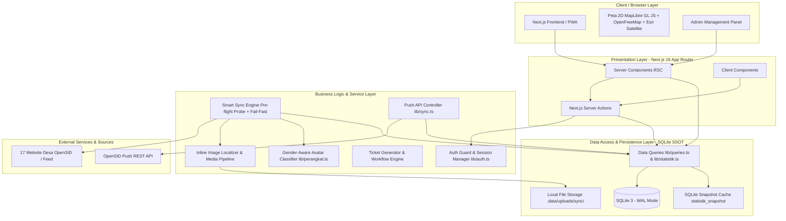

# ARCHITECTURE BLUEPRINT — PORTAL KECAMATAN BANJARMANGU

## 1. High-Level System Architecture

---

## 2. Layering & Responsibility Separation

### A. Presentation Layer (`app/*`, `components/*`)
- **Server Components (RSC):** Merender halaman secara instan di server dengan direct DB query untuk kecepatan LCP optimal dan SEO ramah mesin pencari.
- **Client Components (`"use client"`):** Terisolasi untuk komponen interaktif seperti peta MapLibre GL JS (`components/peta-banjarmangu.tsx`) dengan multi-basemap switcher (Elegan, Terang, Satelit), filter tabs, modal, dan interaktivitas admin.
- **Universal SafeImage (`components/safe-image.tsx`):** Komponen gambar terlindungi yang otomatis menangkap event `onError` dan mengganti sumber gambar yang rusak ke gambar kolase kegiatan desa (`/placeholder-artikel.jpg`).
- **Zero On-The-Fly Network Fetch di Halaman Publik:** Halaman detail artikel (`app/artikel/[slug]/[artikel]/page.tsx`) dan halaman statistik (`app/statistik/page.tsx`) 100% membaca data lokal dari SQLite dan file lokal di disk. Tidak ada latensi jaringan atau risiko terhalang Cloudflare WAF saat pengunjung membuka portal.

### B. Business Logic & Sync Layer (`lib/*`, `app/api/*`)
- **Smart 2-Phase Sync Engine (`lib/sync.ts` & `/api/sync/probe`):**
  1. *Phase 1 (Pre-flight Probe):* Memeriksa konektivitas 17 desa secara paralel (3 detik) untuk memetakan status `online` vs `blocked_waf` Cloudflare.
  2. *Phase 2 (Selective Sync & Enrichment):* Menyinkronkan artikel berita, foto pamong, dan data statistik kependudukan.
  3. *Article Body Enrichment:* Mengambil HTML penuh artikel berita dari OpenSID jika feed RSS desa hanya menyajikan kutipan pendek 300 char berakhiran `[...]`.
  4. *Inline Image Localizer (`localizeHtmlImages`):* Mendeteksi seluruh tag `` di dalam teks berita dan profil desa, mengunduh file gambarnya ke `.data/uploads/sync/`, dan menulis ulang URL-nya menjadi rute lokal `/foto/sync/...`.
- **Gender-Aware Avatar Generator (`lib/perangkat.ts`):** Mengklasifikasikan gender aparatur desa secara otomatis berdasarkan nama dan jabatan untuk menyajikan avatar fallback profesional (`/wuser.png` untuk perempuan dan `/kuser.png` untuk laki-laki) jika desa tidak mengunggah foto pamong.
- **Push Controller (`app/api/push/*`):** Menangani kiriman REST API langsung dari instalasi OpenSID desa menggunakan validasi `X-API-Key`.
- **Authentication & Security (`lib/auth.ts`):** SHA-256 hash validation, single-token session cookies (`admin_session`), dan role checking dengan mitigasi brute-force IP rate limiting.

### C. Data Access & Persistence Layer (`lib/db.ts`, `lib/queries.ts`, `lib/statistik.ts`)
- **SQLite Single Source of Truth (SSOT):** Database SQLite lokal (`.data/portal.db`) adalah sumber data utama seluruh statistik kependudukan (13 kategori demografi). Agregasi kecamatan merespons instan (<5ms) tanpa request eksternal.
- **Cache Management (`clearStatistikCache` & `revalidatePath`):** Setiap kali proses sync selesai, snapshot in-memory dan SQLite snapshot di-flush otomatis sehingga data baru langsung tampil tanpa stale cache.
- **ACID & Concurrency:** Write-Ahead Logging (WAL mode) dengan `busy_timeout = 30000` mencegah error `database is locked` saat admin melakukan sync bersamaan dengan kunjungan publik.
